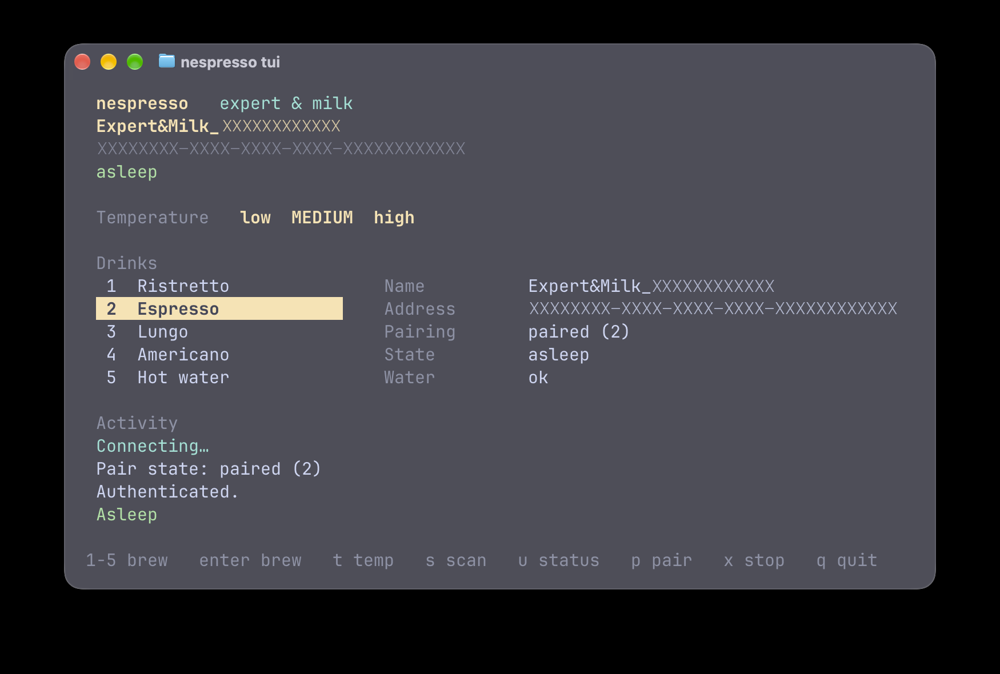

# nes-expert

Unofficial macOS terminal app for a Nespresso Expert & Milk. It scans, pairs, brews, and reads basic state. Nespresso has not made or endorsed it. The pairing key stays in your home directory, not in this repository.

Requires Python 3.9+ and a Mac with Bluetooth.



## Install

```bash
python3 -m venv .venv
source .venv/bin/activate
pip install -e .
```

That installs `bleak` and the `nespresso` command. It stays inside `.venv` until that environment is active.

To run it from any directory, link the command onto your `PATH`. From the project directory:

```bash
mkdir -p ~/.local/bin
ln -s "$(pwd)/.venv/bin/nespresso" ~/.local/bin/nespresso
```

If a new terminal does not find `nespresso`, add this to `~/.zshrc` and open a new terminal:

```bash
export PATH="$HOME/.local/bin:$PATH"
```

The link points at this checkout. Move the project folder and run the `ln` command again. `rm ~/.local/bin/nespresso` removes the link.

The first Bluetooth call asks for permission. Allow the terminal (or Python) under **System Settings → Privacy & Security → Bluetooth**.

Quit the Nespresso phone app before connecting. The machine accepts one Bluetooth connection, and one pairing key.

## Usage

```bash
nespresso scan
nespresso pair
nespresso brew espresso
nespresso brew lungo --temp high
nespresso status
nespresso stop
nespresso tui
```

Drinks: `ristretto`, `espresso`, `lungo`, `hotwater`, `americano`.
Temperature: `low`, `medium`, or `high`. The default is `medium`.

```bash
nespresso brew espresso --temp low
nespresso brew hotwater --temp high
nespresso brew americano --address XXXXXXXX-XXXX-XXXX-XXXX-XXXXXXXXXXXX
```

On macOS the address is a UUID, not a MAC address. `scan` prints the name and the address. Names look like `Expert&Milk_…`.

`nespresso tui` is the full-screen terminal. Number keys brew, `t` changes temperature, `s` scans, `u` reads status, `p` pairs, `x` stops, `q` quits.

`python3 brew.py espresso` still works and forwards to `nespresso brew`.

## Pairing

The first successful `pair` or `brew` on an unpaired machine generates an 8-byte key and stores it in `~/.nespresso_auth.json`. Later commands reuse that file, so a brew is one shot. The file is owner read/write only. The key is not printed.

If the machine is already paired (usually to the phone app), it will refuse a new key. Factory-reset it, then pair:

1. Turn the machine off and close the slider.
2. Hold the brew button for 6 seconds, until both dials flash.
3. Select Lungo and press brew. The Lungo light blinks.
4. Turn the temperature dial to maximum and press brew.
5. All lights blink when the reset is done.

To exit that menu without resetting, press brew while the temperature dial is not at maximum.

A factory reset clears the phone app's pairing, cup sizes, and water-hardness setting. Run `nespresso pair` before opening the phone app again, or the app will take the key back.

Reuse the saved key when you can. Each new pairing takes one of the machine's key slots. One report puts the failure around 25 slots, after which Bluetooth pairing stops until the module's flash is erased with a programmer.

`nespresso pair` and `--reset-auth` both create a new key. `--reset-auth` is for doing that inside `brew` or `status`:

```bash
nespresso brew espresso --reset-auth
```

Delete `~/.nespresso_auth.json` to forget the saved machine. Do not commit that file.

## Status

`status` reads whatever the machine allows after authentication: pairing state, water, descaling, slider, serial, and firmware when those characteristics answer. The decoded fields come from public notes on this protocol and can differ by firmware. The raw status bytes are printed too.

## Troubleshooting

- **No machine found.** Turn the machine on, stand close, and quit the Nespresso app.
- **Bluetooth is off or permission was denied.** Check System Settings, then run the command again.
- **Pairing did not stick.** Factory-reset, then `nespresso pair` while the phone app is closed.
- **The brew was refused.** Open the slider, insert a capsule, and close the slider. Empty the drip tray if the status says to.
- **Prepare step skipped.** Some firmware ignores the optional prepare write. The brew frame is still sent. Pass `--no-prepare` to skip that write.

## Layout

```
src/nespresso/    CLI, terminal UI, and BLE session
brew.py           old `python3 brew.py espresso` entry
```

The BLE frames are the ones already known to work on Expert & Milk: authenticate on service `06aa1910-…`, then write `0305070400000000` plus a temperature byte and a drink byte to the command characteristic.

## Sources

These public notes are where the UUIDs, the auth flow, and the brew frames come from.

- [fsalomon/nespresso-expert-ble](https://github.com/fsalomon/nespresso-expert-ble) — Expert example. The auth value is 8 bytes written to `06aa3a41`, and its first hex digit is 8.
- [farminf's Expert notes](https://gist.github.com/farminf/94f681eaca2760212f457ac59da99f23) — sniffed brew frames (`03050704000000000101` is a low espresso), the prepare write `01100800000200c8000000`, and stop `03060102`.
- [petergullberg/brewbutton](https://github.com/petergullberg/brewbutton) — Expert status bits, slider (`00` open, `02` closed), temperature and drink bytes, and the command-response errors.
- [bulldog5046/ha_nespresso_integration](https://github.com/bulldog5046/ha_nespresso_integration) — pairing without the phone app: write `01` to `06aa3a61`, then the new key. Also the limited key-slot warning above.
- [FezVrasta/ha-nespresso-smart PROTOCOL.md](https://github.com/FezVrasta/ha-nespresso-smart/blob/main/PROTOCOL.md) — GATT table and pair-state values (`0` and `1` unbound, `2` paired, `3` undefined) for the shared `06aa` profile. The notes describe Vertuo machines. A Vertuo does not accept a remote brew. This project uses that GATT map and those pair-state values, and the Expert status table from brewbutton.
- [cryptax, BSides Munich notes](https://github.com/cryptax/talks/blob/master/BSidesMunich-2020/nespresso-techinfo.md) — the same services on a Prodigio: serial number, machine-info versions, brew and cancel frames, slider values, and response error codes.

The brew that works on a Nespresso Expert & Milk is the farminf frames, the fsalomon auth write, and the Home Assistant pairing steps.
